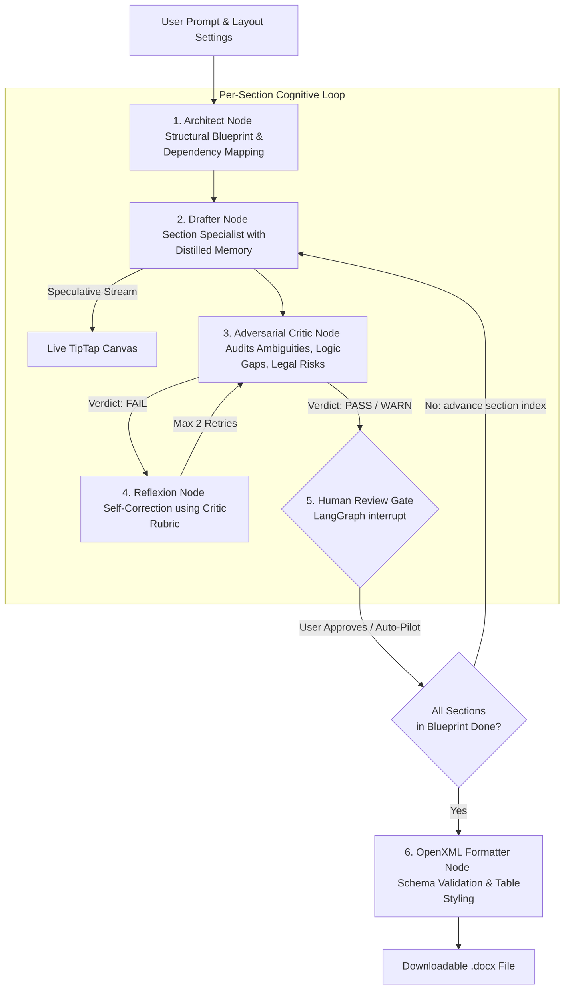

# Drafter 📄⚡
### Production-Grade Live AI Document Editor & Cognitive Agent

[](https://github.com/warisfamiliyaconnect/drafter/actions/workflows/ci.yml)
[](https://github.com/warisfamiliyaconnect/drafter/actions/workflows/codeql.yml)
[](https://www.python.org/downloads/release/python-3110/)
[](https://nextjs.org/)
[](https://opensource.org/licenses/MIT)

Drafter is an enterprise-grade AI-native live document workspace. It combines an **Autonomous Cognitive Document Agent (`AutonomousDocumentAgent`)** built on **LangGraph**, a **full-fidelity Word/Google Docs WYSIWYG editor (TipTap)**, and **bidirectional `.docx` (OpenXML ISO/IEC 29500) parity**.

---

## 🏛️ System Architecture



---

## 📦 Project Structure

```
Drafter/
├── .github/                     # GitHub Actions CI/CD workflows & templates
│   ├── workflows/ci.yml         # Automated monorepo test & build pipeline
│   ├── workflows/codeql.yml     # CodeQL static security analysis
│   └── dependabot.yml           # Automated dependency update bot
├── backend/                     # FastAPI & LangGraph backend engine
│   ├── app/
│   │   ├── agent/               # Cognitive graph (Architect, Drafter, Critic)
│   │   ├── services/            # OpenXML parser, exporter, and inference
│   │   └── main.py              # SSE streaming & surgical edit API
│   ├── Dockerfile
│   └── requirements.txt
├── frontend/                    # Next.js 16 (App Router) + TipTap WYSIWYG
│   ├── src/
│   │   ├── app/                 # Next.js layout & canvas page
│   │   └── components/editor/   # TipTap editor & speculative streaming UI
│   ├── Dockerfile
│   └── package.json
├── ai_engine/                   # AI configuration & local model registry
├── scripts/                     # Pre-flight validation & git sync scripts
│   ├── git-sync.ps1             # PowerShell automated sync tool
│   └── git-sync.sh              # Unix/macOS automated sync tool
├── docker-compose.yml           # Unified multi-container orchestration
└── pyproject.toml
```

---

## 🚀 Quick Start

### 1. Prerequisites
- **Python**: 3.11+
- **Node.js**: 20+
- **Docker & Docker Compose** (Optional, for containerized run)

### 2. Environment Configuration
Copy the provided environment template:
```bash
cp .env.example .env
```

### 3. Running with Docker Compose (Recommended)
```bash
docker compose up --build
```
- Frontend: [http://localhost:3000](http://localhost:3000)
- Backend API Docs: [http://localhost:8000/docs](http://localhost:8000/docs)

### 4. Running Locally

#### Backend Setup
```bash
# Create and activate virtual environment
python -m venv venv
# On Windows:
.\venv\Scripts\activate
# On Linux/macOS:
source venv/bin/activate

# Install dependencies
pip install -r backend/requirements.txt

# Start backend server
uvicorn backend.app.main:app --reload --port 8000
```

#### Frontend Setup
```bash
cd frontend
npm install
npm run dev
```

---

## 🔄 Professional Synchronization

To pull latest remote changes, run health checks (TypeScript typecheck, Python syntax compile, large-file guards), and push cleanly:

- **Windows (PowerShell):**
  ```powershell
  .\scripts\git-sync.ps1
  ```
- **Linux / macOS:**
  ```bash
  chmod +x ./scripts/git-sync.sh
  ./scripts/git-sync.sh
  ```

---

## 🛡️ CI/CD & Security

This repository is enforced by automated GitHub Actions:
- **Continuous Integration (`ci.yml`)**: Verifies Python syntax/linting, pytest suites, TypeScript compilation (`tsc --noEmit`), ESLint checks, and Next.js builds on every push and PR.
- **CodeQL Security (`codeql.yml`)**: Continuous static code analysis scanning for security vulnerabilities.
- **Dependabot (`dependabot.yml`)**: Automated weekly dependency security patching.

---

## 📄 License
This project is licensed under the MIT License.
