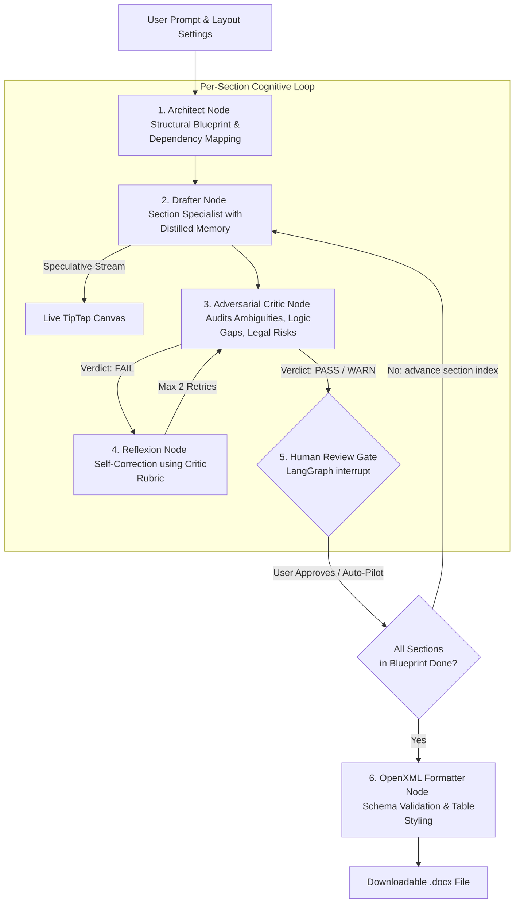
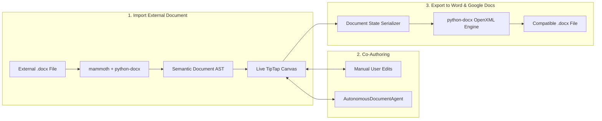

# Drafter: Production-Grade Live AI Document Editor & Agent

This master specification defines **Drafter**: an enterprise, production-grade AI-native live document workspace. It combines an **Autonomous Cognitive Document Agent (`AutonomousDocumentAgent`)** built on **LangGraph**, a **full-fidelity Word/Google Docs WYSIWYG editor (TipTap)**, and **bidirectional `.docx` (OpenXML ISO/IEC 29500) compatibility**.

---

## 1. Production-Grade Cognitive Architecture

The `AutonomousDocumentAgent` rejects naive single-prompt generation in favor of a **multi-node Actor-Critic-Refiner cyclic graph** with self-correction, distilled memory, and checkpointing.

---

## 2. Core Production-Grade Capabilities

### 2.1 Actor-Critic-Refiner with Reflexion (Self-Correction)
* **Drafter Node**: Focuses on drafting deep, substantive prose for one section at a time.
* **Adversarial Critic Node**: Audits the drafted section using rigid evaluation criteria (factual consistency, logical completeness, absence of vague boilerplate).
* **Refiner Node**: If the critic flags issues, the Refiner reads the critique, repairs the specific flaws, and resubmits the section before the user ever sees it.

### 2.2 The "Truth" Layer: Hierarchical Distilled Memory & Glossary
To prevent contradictions in long documents (10–50+ pages):
* **Strict Global Glossary**: A locked store of defined terms (e.g., "The Company" $\rightarrow$ "Acme Corp"). The Critic Node automatically fails any draft that violates glossary terms.
* **Master Outline**: Complete list of sections and statuses.
* **Distilled Memory Ledger**: 1-sentence summaries and defined terms extracted from previously drafted sections.
* **Immediate Anchor**: The exact preceding paragraph to guarantee smooth transitions.

### 2.3 The "UX" Layer: Speculative Streaming
To hide the latency of the cognitive loop:
* **Ghost Streaming**: The initial Draft is streamed immediately to the canvas in a "Pending" state (visual cue: italic/gray).
* **Background Validation**: While the user reads, the Critic and Refiner run.
* **Silent Commit**: Once the Critic passes the text, the "Ghost" text smoothly transitions to the "Final" version.

### 2.4 The "Integrity" Layer: OpenXML Parity & Validation
* **Twin-Render Validation**: Every major section completion triggers a headless `.docx` export in the background to verify the layout.
* **Schema Guardrails**: Pre-export validation to ensure the generated OpenXML doesn't contain illegal nested tags that would trigger Word's "file corrupted" error.

### 2.5 Fault-Tolerant Persistence & Event Sourcing
* **Checkpointing**: Backed by `SqliteSaver` or PostgreSQL.
* **Event Sourcing**: Instead of saving just the text, we save the event stream (`DraftStarted` $\rightarrow$ `CritiqueFailed` $\rightarrow$ `Refined`). This allows perfect "Time Travel" undo/redo.

---

## 3. High-Fidelity Bidirectional Document Pipeline

---

## 4. Detailed Implementation Roadmap

### Phase 1: Production Core MVP
**Goal:** End-to-end flow from `.docx` import $\rightarrow$ AI Drafting $\rightarrow$ `.docx` export.

**Step 1.1: The Backend Engine (`FastAPI + LangGraph`)**
- [ ] **Project Setup**: Install `langgraph`, `python-docx`, `mammoth`, `fastapi`.
- [ ] **Cognitive Graph**: Implement `DocumentGraphState` with `SqliteSaver`.
- [ ] **Nodes**: `plan_blueprint` $\rightarrow$ `draft_paragraph` $\rightarrow$ `critic_audit` $\rightarrow$ `refine_paragraph`.
- [ ] **Glossary Store**: Implement a simple key-value store in the state to lock terminology.
- [ ] **Import/Export**: Basic `docx_parser.py` (mammoth) and `exporter.py` (python-docx).
- [ ] **SSE API**: Endpoint for streaming tokens and agent state transitions.

**Step 1.2: The Frontend Canvas (`Next.js + TipTap`)**
- [ ] **Rich Canvas**: TipTap editor with basic formatting (H1-H3, Bold, Italic, Tables).
- [ ] **Agent Panel**: Sidebar for prompt input and "Auto-Draft" control.
- [ ] **Document Layout**: CSS-based A4 page rendering with margins.
- [ ] **Integration**: Connect SSE stream to TipTap (injecting text as it arrives).

---

### Phase 2: Human-in-the-Loop & Speculative UX
**Goal:** Make the AI feel like a collaborator, not a black box.

**Step 2.1: Speculative UX Implementation**
- [ ] **Ghost-Text Logic**: Frontend state to distinguish between `PENDING` and `FINAL` text.
- [ ] **Transition Animations**: Smooth visual transition when the Critic approves a paragraph.
- [ ] **Interrupt Gates**: Use LangGraph `interrupt()` to pause between sections for user approval.

**Step 2.2: Surgical AI Edits**
- [ ] **Selection-Aware API**: Send only the selected text + surrounding context for targeted rewrites.
- [ ] **Inline Suggestions**: Display AI suggestions as "Comments" or "Diffs" before merging.

**Step 2.3: Advanced Layouts**
- [ ] **Dynamic Tables**: AI-driven table generation and manual editing in TipTap.
- [ ] **Layout Overrides**: UI to change margins, orientation, and paper size.

---

### Phase 3: Enterprise Integrity & Time Travel
**Goal:** Zero-failure exports and perfect session recovery.

**Step 3.1: High-Fidelity Export Validation**
- [ ] **Headless Validator**: Background process that exports and validates OpenXML schema.
- [ ] **Twin-Render Check**: Compare editor AST vs. exported XML to detect layout drift.

**Step 3.2: Time Travel & Event Sourcing**
- [ ] **Event Store**: Replace simple checkpoints with an event-sourced ledger.
- [ ] **Timeline Scrubber**: UI to roll back the document to any specific state/event.

**Step 3.3: Scale & Optimization**
- [ ] **Distilled Memory Ledger**: Implement automated summarization of previous sections for infinite context.
- [ ] **PostgreSQL Migration**: Move from SQLite to Postgres for multi-user production scaling.

---

## 5. Technology Stack Summary

| Layer | Technology | Production Role |
| :--- | :--- | :--- |
| **Agent Engine** | LangGraph | State machine, checkpointing, and cognitive loops |
| **Frontend** | Next.js (App Router) | Host for the editor and agent control panel |
| **Editor Core** | TipTap (ProseMirror) | WYSIWYG interface and AST management |
| **Persistence** | SQLite $\rightarrow$ PostgreSQL | Immutable state and event logging |
| **Backend** | FastAPI (Python) | Orchestration, SSE streaming, and OpenXML logic |
| **DOCX Logic** | `python-docx` / `mammoth` | Strict OpenXML ISO/IEC 29500 compliance |
| **Validation** | Pydantic + Custom Schema | Ensuring strict contracts between agent nodes |
